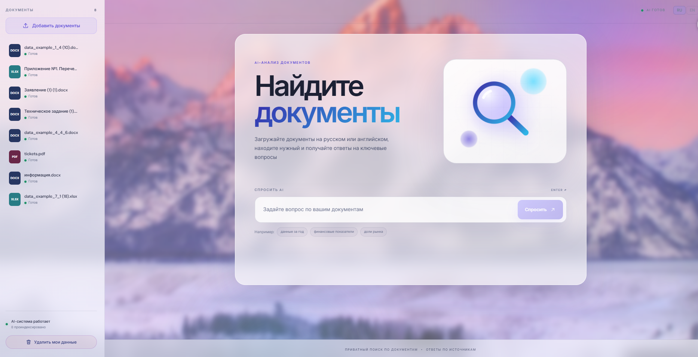
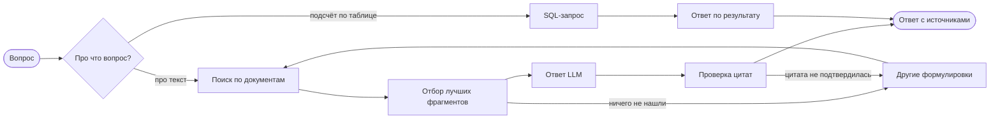

# DocMind

Поиск по документам с помощью ИИ. Загружаешь файлы, задаёшь вопрос обычным языком и получаешь ответ, который опирается на эти файлы: в каком документе нашлось, на какой странице или в каких строках, и с цитатой из текста. Если вопрос про таблицу (средняя зарплата, сумма за год), считает точно, через SQL, и показывает сам запрос.

Работает с русскими и английскими документами, в том числе вперемешку: можно спросить по-английски про русский договор. Ответ приходит на языке вопроса.



## Что умеет

- принимает PDF, DOCX, XLSX, XLS и CSV, до 50 файлов за раз;
- читает сканы PDF через OCR (Tesseract, русский и английский);
- ищет по смыслу и по словам одновременно, потом перепроверяет найденное;
- показывает источник: документ, место в нём и цитату, которую сервер сам сверяет с текстом;
- считает по таблицам точно, а не «примерно» языковой моделью;
- не придумывает: если ответа в файлах нет, так и пишет.

## Как это устроено



Коротко по шагам:

1. **Загрузка.** Файл читается в отдельном изолированном процессе с лимитом по времени и памяти, чтобы битый или вредный файл не мог повесить сервер. Текст режется на фрагменты (сплиттер из LangChain), у фрагментов из таблиц сохраняется строка заголовка.
2. **Индекс.** Для каждого фрагмента считается эмбеддинг, он хранится в ChromaDB (в памяти, без записи на диск). Рядом строится словесный индекс (BM25 с учётом русской и английской морфологии).
3. **Поиск.** Смысловой поиск в ChromaDB и словесный по BM25 объединяются (RRF), потом кросс-энкодер переоценивает лучшие фрагменты. Если вопрос на другом языке, чем документы, запрос переводится.
4. **Ответ.** В LLM уходят только найденные фрагменты и строгая инструкция отвечать по ним. Модель возвращает JSON с ответом и ссылками на фрагменты.
5. **Проверка.** Сервер смотрит, что цитата действительно есть в указанном фрагменте. Нет цитаты, значит, ответ не показывается, а поиск повторяется.
6. **Таблицы.** Для вопросов вида «сколько», «в среднем», «по месяцам» модель пишет один SELECT, он выполняется в DuckDB в песочнице (без доступа к файлам и сети), результат объясняется словами.

Каждый шаг агента виден в интерфейсе («Как это найдено») и приходит по ходу работы через Server-Sent Events.

## Технологии

**Бэкенд:** Python 3.11+, FastAPI, LangGraph, LangChain (разбиение текста, интеграция с Chroma), ChromaDB, sentence-transformers, DuckDB, pypdf / pypdfium2, python-docx, openpyxl, Tesseract.

**Модели:** эмбеддинги `intfloat/multilingual-e5-small`, реранкер `cross-encoder/mmarco-mMiniLMv2-L12-H384-v1`, ответы генерирует любая OpenAI-совместимая LLM (по умолчанию DeepSeek).

**Фронтенд:** React 18, TypeScript, Vite, обычный CSS, интерфейс на русском и английском.

**Деплой:** Docker Compose, Caddy (HTTPS, заголовки безопасности).

## Запуск

Нужны Python 3.11+ (проверено на 3.12), Node.js 18+ и ключ к LLM.

```bash
# бэкенд
cd backend
python -m venv .venv
.venv\Scripts\activate          # Linux / macOS: source .venv/bin/activate
pip install -r requirements.txt -c constraints.txt
cp .env.example .env            # впишите LLM_API_KEY
uvicorn app.main:app --port 8000 --workers 1

# фронтенд, в другом терминале
cd frontend
npm ci
npm run dev                     # http://localhost:5173
```

При первом запуске скачиваются модели (около 1 ГБ), для этого нужен интернет. Дальше они грузятся из локального кэша. Для OCR должен стоять Tesseract с русским языком (`tesseract-ocr-rus`), без него сканы просто не распознаются.

Через Docker:

```bash
cp backend/.env.example backend/.env
SITE_ADDRESS=localhost docker compose up -d --build
```

Модели скачиваются при сборке образа, а в контейнере работают без интернета. Поэтому модель эмбеддингов в `backend/.env` должна совпадать с `ARG EMBEDDING_MODEL` в `backend/Dockerfile` (или передайте её при сборке: `docker compose build --build-arg EMBEDDING_MODEL=...`).

## Настройки (`backend/.env`)

| Переменная | Что делает | В `.env.example` |
|---|---|---|
| `LLM_API_KEY` | ключ к LLM | обязательно |
| `LLM_BASE_URL`, `LLM_MODEL` | адрес и модель | DeepSeek |
| `EMBEDDING_MODEL` | модель эмбеддингов (`-base` и `bge-m3` точнее, но медленнее) | e5-small |
| `RERANKER_MODEL` | реранкер, пусто отключает | mmarco (лёгкий) |
| `OCR_ENABLED` | распознавание сканов | `true` |
| `MAX_UPLOAD_MB` | размер одного файла | `200` |
| `MAX_FILES_PER_UPLOAD` | файлов за одну загрузку | `50` |
| `ACCESS_CODE` | код доступа к приложению, если оно в открытом доступе | не задан |

Полный список в `.env.example`.

## Приватность

На диск ничего не пишется: файлы, фрагменты, векторы и таблицы живут в памяти процесса и удаляются через 4 часа простоя, при нажатии «удалить» или при перезапуске. Но сам вопрос, найденные фрагменты и (для таблиц) схема с парой строк-примеров отправляются LLM-провайдеру. Для конфиденциальных данных используйте проверенного провайдера или свою модель через `LLM_BASE_URL` (vLLM, Ollama).

## Безопасность

Текст из документов считается недоверенным и подаётся в модель в отдельных тегах как данные, а не как инструкции. SQL от модели проходит несколько проверок: только один SELECT, чёрный список функций, DuckDB без внешнего доступа, лимиты по памяти и времени. Файлы проверяются по сигнатуре, размеру и степени сжатия. Есть лимиты запросов по IP, ограничение числа сессий и необязательный код доступа. Сессии выдаёт только сервер.

## Тесты

```bash
cd backend && pip install -r requirements-ci.txt -c constraints.txt && pytest -q
cd frontend && npm test && npm run lint && npm run build
```

Больше 120 тестов на бэкенде и 12 на фронтенде. Они идут на заглушках вместо моделей и LLM, поэтому без интернета. Качество на реальных моделях проверяет отдельный скрипт:

```bash
cd backend
python -m eval.run_eval --retrieval-only    # только поиск, без LLM
python -m eval.run_eval                      # поиск, ответы, цитаты, SQL
```

## Ограничения

- Один процесс (`--workers 1`): всё хранится в памяти, в том числе векторы в ChromaDB. Для нескольких серверов состояние нужно вынести в Redis, а векторы в серверную базу (pgvector, Qdrant).
- Смысловой поиск в Chroma приближённый (HNSW), поэтому после смены настроек качество стоит перепроверить через `eval`.
- Ответ приходит целиком, по токенам не стримится, потому что модель должна вернуть проверяемый JSON.
- Формулы в xlsx без сохранённого значения читаются как пустые ячейки.
- Рукописный текст и таблицы внутри картинок OCR не восстанавливает.
- Порог отсечения реранкера (`RERANK_MIN_SCORE`) лучше подобрать на своих документах через `eval`.
- Свой фон интерфейса: положите картинку в `frontend/public/background.jpg`.

## Лицензия

Личный проект. Все права защищены, копировать и использовать код без письменного разрешения автора нельзя.
